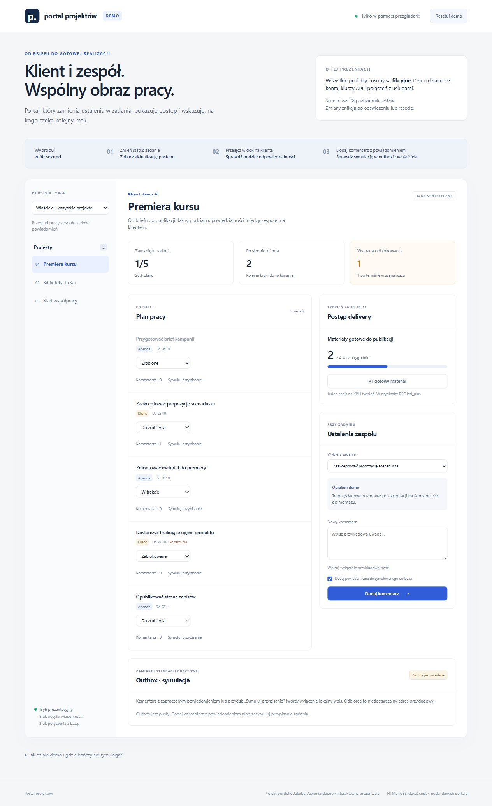

# Portal projektów — demo portfolio

Interaktywna prezentacja portalu współpracy agencji z klientem. Pokazuje podział odpowiedzialności, zadania, komentarze, tygodniowe KPI i symulowany outbox powiadomień. Wszystkie osoby, projekty i metryki są wymyślone.

**[Otwórz interaktywne demo](https://dzwoniar.github.io/portal-projektowy-demo/)** · [CI](https://github.com/dzwoniar/portal-projektowy-demo/actions)

<details>
<summary>Podgląd interfejsu</summary>



</details>

## Uruchomienie

```sh
git clone https://github.com/dzwoniar/portal-projektowy-demo.git
cd portal-projektowy-demo
```

Z katalogu projektu, korzystając z Pythona 3:

```sh
python -m http.server 8000 --bind 127.0.0.1
```

Otwórz [demo lokalne](http://127.0.0.1:8000/). Nie wymaga instalowania pakietów, konta, bazy danych ani zmiennych środowiskowych. Użyj serwera HTTP — moduły JavaScript nie są przeznaczone do otwierania przez `file://`.

## Scenariusz na minutę

1. Zmień status zadania w projekcie „Premiera kursu”. Podsumowanie przeliczy postęp.
2. Przełącz perspektywę na „Klient demo A”. Widać jeden projekt, a status zadań agencji jest zablokowany do edycji.
3. Dodaj przykładowy komentarz z zaznaczonym powiadomieniem. Wróć do właściciela i sprawdź lokalny outbox. Przycisk „Resetuj demo” przywraca dane startowe.

`+1` zwiększa KPI bieżącego tygodnia scenariusza. „Symuluj przypisanie” pokazuje zdarzenie powiadomienia bez zmieniania przypisanej osoby i bez wysyłki.

## Pliki i architektura

```text
index.html + styles.css
           ↓
        app.mjs          renderowanie DOM przez textContent
           ↓
       store.mjs         adapter demonstracyjny + syntetyczne dane w pamięci
           ↓
    zadania / komentarze / KPI / lokalny outbox
```

Nie ma zależności z CDN ani połączeń `fetch`. CSP blokuje połączenia `connect-src 'none'`, wysyłkę formularzy i obce skrypty. Dane wpisane w demo nie są zapisywane w cookie, localStorage ani na serwerze. Odświeżenie strony usuwa zmiany. Nie wpisuj rzeczywistych danych klientów.

## Powiązanie z pierwotnym projektem

Oryginalny portal pozostaje prywatny. Poniższe ścieżki opisują pochodzenie modelu w tamtym repozytorium; nie są plikami do uruchomienia w tym publicznym eksporcie.

To osobny frontend demonstracyjny, przygotowany na podstawie mechanizmów wewnętrznego portalu. Nie jest wdrożeniem tamtej aplikacji. Nazwy pól, statusów i ról odpowiadają jej modelowi danych; adapter w pamięci zastępuje bazę i usługi.

| Prezentowany mechanizm | Adapter demo | Odpowiednik w oryginalnym repozytorium |
| --- | --- | --- |
| Projekt i zadania | `getProjects`, `getTasks`, `setTaskStatus` | `sql/01_baza.sql`, tabele `projekty` / `zadania`; `public/index.html` i `public/panel.html` |
| Właściciel i klient | `setRole`, sprawdzenie `klient_id`, `strona` | `sql/02_rls.sql`: role, polityki RLS i ochrona edycji zadań |
| Komentarze | `getComments`, `addComment` | tabela `komentarze` i jej polityki dostępu |
| Tygodniowy KPI | `incrementKpi`; jeden zapis `(kpi_id, tydzien)` | `kpi`, `kpi_tygodnie`, funkcja RPC `kpi_plus` |
| Powiadomienie | lokalny outbox z adresem `example.invalid` | `sql/05_powiadomienia.sql`: triggery przypisania i wzmianki, obecnie placeholder bez transportu |

Mapa wskazuje pochodzenie kontraktów. Demo nie importuje starego UI ani nie wykonuje SQL. Identyfikatory w adapterze są czytelnymi skrótami; baza używała UUID. Zawężone są m.in. KPI do bieżącego tygodnia, wzmianka do checkboxa oraz wybór klienta do jednego przykładu. Pełny portal zawierał także uwierzytelnianie Supabase, Storage, Realtime, raporty i pozostałe moduły, które nie są częścią prezentacji.

Przełączanie widoków jest narzędziem demonstracji. Kontrola w JavaScript nie zastępuje uwierzytelniania i autoryzacji na serwerze. Stan produkcji, wydajność i izolacja rzeczywistych kont nie są przez to demo testowane.

## Weryfikacja

Node.js 22+; z katalogu tego repozytorium, bez instalowania pakietów:

```sh
npm test
```

Sześć testów offline obejmuje m.in. odmowę działań w widoku klienta, brak częściowych zapisów, KPI, reset, symulowane powiadomienia, CSP i brak wywołań zewnętrznych w plikach demo. Nie wymagają żadnych sekretów.

## Pochodzenie i zakres

To nowa, odrębna publikacja prezentacyjna przygotowana w listopadzie 2026, bez kopiowania starej historii Git, danych operacyjnych, załączników, kont i materiałów klientów. Nie jest pełnym kodem ani wdrożeniem pierwotnej aplikacji. Źródłem mechaniki są jej projekty, role, zadania, komentarze oraz KPI; tutaj zastąpiono usługi adapterem w pamięci. Dokumentacja i wariant demonstracyjny zostały dopracowane z pomocą narzędzi AI.

Strona ma charakter portfolio. Hosting może standardowo rejestrować żądania dostępu; aplikacja nie przesyła treści formularza ani komentarzy. Demo nie służy do pracy z rzeczywistymi danymi.
